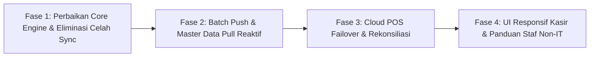

# Rencana Implementasi: Hybrid Sync Database (PC Toko Offline-First & Cloud VPS Failover)

**Tanggal Mulai:** 23 November 2026  
**Versi:** 1.1 (Hasil Audit Mendalam & Optimalisasi Celah Arsitektur)  
**Dokumen Induk:** [ADR 0013: Hybrid Database Sync Architecture](file:///var/www/ute-parts-erp/docs/adr/0013-hybrid-database-sync-architecture.md)  
**Tujuan:** Memastikan aplikasi kasir & backoffice Bremspace ERP dapat beroperasi secara offline penuh di PC Toko, sinkron dua arah dengan VPS Cloud, dan mampu failover ke VPS saat PC toko down tanpa mengorbankan performa (selalu responsif < 50ms).

---

## 1. Analisis Celah & Hasil Audit (Audit Findings)

Berdasarkan audit mendalam terhadap modul `app/Modules/Sync/`, ditemukan 5 celah kritis yang harus diselesaikan:

1. **Celah Filter `pull()` di Cloud (`SyncController.php:58`)**:
   * *Masalah*: Node cloud saat ini hanya menyajikan `event_type = 'order.online_paid'`. Jika owner menambah produk, mengubah harga, atau mengedit data pelanggan via cloud saat PC toko offline, data tersebut **tidak akan pernah ditarik** oleh PC toko saat online kembali.
   * *Solusi*: Buka query `pull()` agar menyajikan semua event master data (`produk.upsert`, `pelanggan.upsert`, dll) dan transaksi failover (`transaksi.pos_cloud`).

2. **Celah Transaksi POS Lokal Belum Memiliki Observer Otomatis**:
   * *Masalah*: Di `SyncObserverBootstrap`, `Transaksi` hanya diamati pada node cloud untuk pesanan online. Transaksi kasir fisik yang dibuat di `primary_store` belum otomatis masuk ke `hybrid_sync_outbox` (hanya `StokLog` yang masuk).
   * *Solusi*: Buat `TransaksiPosSyncObserver` untuk node `primary_store` agar faktur dan rincian item kasir otomatis diantrekan ke outbox.

3. **Celah Risiko Loop Echo (*Anti-Ping-Pong Sync*)**:
   * *Masalah*: Saat node toko mengimpor produk dari cloud, penyimpanan model berpotensi memicu observer lokal dan mengirim balik produk yang sama ke cloud.
   * *Solusi*: Terapkan `saveQuietly()` dan pasang `SyncExecutionGuard` untuk mematikan observer saat memproses inbox.

4. **Inefisiensi Pengiriman Tunggal (Single-Item Push)**:
   * *Masalah*: Setiap item outbox saat ini mendispatch 1 HTTP request (`PushHybridSyncJob`). Jika satu transaksi kasir memiliki 10 item, sistem melakukan 10 kali koneksi HTTP berturut-turut.
   * *Solusi*: Buat batching aggregator (`POST /api/internal/sync/push-batch`) yang membundel hingga 50 item outbox per request.

5. **Ketiadaan Indikator Responsif UI untuk Kasir**:
   * *Masalah*: Kasir tidak tahu apakah sistem sedang online, offline, atau ada antrean yang belum terkirim.
   * *Solusi*: Komponen Alpine.js `x-sync-status` yang ringan dan reaktif di header kasir.

---

## 2. Rencana Kerja Bertahap (Implementation Roadmap)

---

## 3. Rincian Task & Kriteria Penerimaan (*Acceptance Criteria*)

### Fase 1: Perbaikan Core Engine & Eliminasi Celah Sync
Fokus: Menutup celah observer dan loop echo agar sinkronisasi dua arah aman dan idempoten.

- [x] **T-01** — Buat `SyncExecutionGuard` (service helper) untuk membungkus operasi ingest agar model disimpan dengan aman tanpa memicu event observer berulang (*anti-echo loop*).
- [x] **T-02** — Buat `TransaksiPosSyncObserver` di `app/Modules/Sync/Observers/` dan daftarkan pada `SyncObserverBootstrap` khusus node `primary_store` agar setiap transaksi POS kasir langsung masuk ke `hybrid_sync_outbox` bersama rincian item, pelanggan, dan pembayaran.
- [x] **T-03** — Perbaiki `SyncController::pull()` pada node cloud agar tidak membatasi hanya pada `order.online_paid`, melainkan mencakup seluruh event master data (`produk.upsert`, `sku_variant.upsert`, `pelanggan.upsert`, `kategori_produk.upsert`, `brand.upsert`, `kualitas_produk.upsert`, `satuan_unit.upsert`, `tipe_hp.upsert`, dan `transaksi.pos_cloud`).
- [x] **T-04** — Validasi `HybridSyncProcessorService::handleTransaksiPos()` agar menangani payload transaksi POS lengkap (faktur, item, kasir, metode pembayaran, potongan stok, dan posting jurnal akuntansi secara otomatis di cloud).
- [x] **T-05** — Pastikan pemotongan stok pada saat sinkronisasi (`handleStokMutasi`) menggunakan logika mutasi delta kuantitas, bukan menimpa saldo akhir, sehingga mutasi dari toko dan pesanan online terhitung akurat.

### Fase 2: Batch Push & Master Data Pull Reaktif
Fokus: Mengurangi beban network internet toko dengan pengiriman payload massal (batching) terkompresi.

- [x] **T-06** — Tambahkan endpoint `POST /api/internal/sync/push-batch` di `SyncController` yang menerima array hingga 50 event sekaligus dalam satu kali HTTP handshake.
- [x] **T-07** — Perbarui `PushHybridSyncJob` atau buat `BatchPushHybridSyncJob` yang mengambil antrean outbox berstatus `pending` dan mengirimkannya sekaligus ke endpoint batch cloud.
- [x] **T-08** — Perbarui command `php artisan sync:pull` agar mendukung opsi limit dinamis dan langsung mengirim konfirmasi penerimaan (*ACK*) dalam satu batch request.
- [x] **T-09** — Pasang penanganan retry dengan exponential backoff terukur (30s, 60s, 300s, 900s) pada failed jobs tanpa memblokir antrean outbox berikutnya.

### Fase 3: Cloud POS Failover & Rekonsiliasi Bencana
Fokus: Menjamin kasir dapat langsung membuka web cloud jika PC toko mati, dan datanya tersinkron kembali saat PC toko menyala.

- [x] **T-10** — Implementasikan deteksi otomatis nomor faktur kasir:
  - Jika dibuat di node `primary_store`: format `POS-CB{cabang_id}-{YYMM}-{COUNTER}`
  - Jika dibuat di node `cloud_storefront` (mode darurat): format `VPS-CB{cabang_id}-{YYMM}-{COUNTER}`
- [x] **T-11** — Daftarkan observer `TransaksiCloudPosSyncObserver` pada node `cloud_storefront` agar transaksi kasir darurat yang terjadi di cloud masuk ke outbox cloud sebagai event `transaksi.pos_cloud`.
- [x] **T-12** — Tambahkan handler `handleTransaksiPosCloud()` di `HybridSyncProcessorService` pada node toko lokal agar menyerap transaksi darurat tersebut ke database lokal saat command `sync:pull` dijalankan.
- [x] **T-13** — Tulis unit test integrasi simulasi failover: matikan koneksi PC toko, input transaksi di cloud, jalankan sync pull, dan buktikan saldo stok serta laporan transaksi cocok di kedua sisi.

### Fase 4: UI Responsif Kasir & Panduan Staf Non-IT
Fokus: Memberikan pengalaman kasir instan (< 50ms) dan informasi status sinkronisasi yang jelas bagi pengguna non-IT.

- [x] **T-14** — Buat komponen Alpine.js `x-sync-badge` di header layar POS dan Servis yang mendeteksi status internet browser (`navigator.onLine`) dan status antrean outbox.
- [x] **T-15** — Desain 3 indikator visual ramah staf non-IT:
  - 🟢 **Online & Sinkron**: Semua transaksi berhasil terkirim ke cloud.
  - 🟡 **Menyimpan di PC (X Antrean)**: Transaksi tersimpan aman di PC toko dan sedang antre terkirim.
  - 🔴 **Mode Toko Mandiri (Offline)**: Internet terputus; notifikasi ramah bahwa kasir tetap bisa jualan dan cetak struk tanpa gangguan.
- [x] **T-16** — Pasang tombol manual *"Sinkronkan Sekarang"* di pojok kasir agar staf dapat memicu sinkronisasi seketika saat internet baru saja menyala kembali.
- [x] **T-17** — Siapkan opsi instalasi otomatis PC toko: Docker installer terpaket di `Installer docker/` (one-click `install.bat` dengan Apache + MySQL + auto-worker queue) serta skrip standalone di `scripts/setup-local-store-node.sh` dan `.bat`.
- [x] **T-18** — Susun panduan operasional ramah pemula di `docs/PANDUAN-KASIR-OFFLINE-DAN-FAILOVER.md` lengkap dengan langkah sederhana jika PC toko mati (pindah ke HP/laptop lain).

---

## 4. Jaminan Kualitas & Responsivitas (SLA)

| Parameter Kinerja | Target Standar | Cara Menjamin |
|---|---|---|
| **Waktu Checkout Kasir** | **< 30 milidetik** | Simpan lokal instan; pengiriman ke cloud didelegasikan ke queue background non-blocking. |
| **Pencetakan Struk Thermal** | **< 80 milidetik** | Perintah cetak langsung ke port ESC/POS USB/Bluetooth lokal tanpa melewati cloud. |
| **Kesiapan Failover ke Cloud** | **< 10 detik** | Cukup buka link website cloud toko di browser HP/laptop mana pun. |
| **Ukuran Memori Tambahan** | **< 30 MB RAM** | Service sync menggunakan antrean database native Laravel yang sangat hemat memori. |

---

## 5. Protokol Verifikasi (*Verification Steps*)

1. **Uji Transaksi Offline Kasir**:
   - Putus koneksi internet pada PC toko.
   - Lakukan 5 transaksi kasir berturut-turut.
   - Verifikasi respon layar kasir tetap instan (< 30ms) dan struk tercetak normal.
   - Periksa tabel `hybrid_sync_outbox` lokal: 5 baris event berstatus `pending`.
2. **Uji Pemulihan Jaringan (Auto-Push)**:
   - Hubungkan kembali koneksi internet PC toko.
   - Biarkan queue worker berjalan.
   - Verifikasi tabel `hybrid_sync_outbox` berubah status menjadi `synced`.
   - Buka database cloud di VPS: 5 transaksi kasir muncul lengkap dengan jurnal akuntansi dan pemotongan stok.
3. **Uji Update Master Data dari Cloud saat PC Toko Mati**:
   - Matikan PC toko.
   - Buka web cloud dari laptop lain, tambahkan 2 produk baru dan ubah harga 1 sparepart.
   - Nyalakan kembali PC toko.
   - Jalankan `php artisan sync:pull`.
   - Buka layar kasir di PC toko: 2 produk baru langsung muncul di katalog kasir lokal dengan harga yang sesuai.
