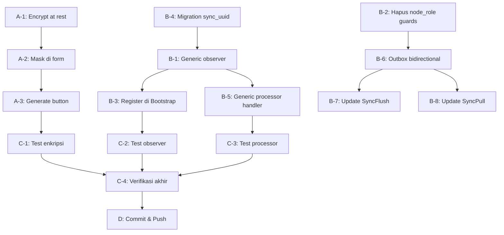

# Plan: Full Bidirectional Backoffice Sync + Secret Encryption

**Tanggal:** 28 November 2026
**Status:** DRAFT — Belum dieksekusi
**Prasyarat:** Semua task Fase 1-4 dari `2026-11-23-hybrid-database-sync-plan.md` sudah ✅ selesai.
**Tujuan:** Dua hal:
1. **Enkripsi `sync_api_secret`** di database, masking di browser, tombol generate
2. **Sinkronisasi bidireksional SEMUA aktivitas backoffice** — bukan hanya POS/master data

---

## Konteks: Apa yang Sudah Sinkron (Baseline)

### Model yang SUDAH punya Observer Sync (19 observer, 16 model):

| Model | Observer | Arah | Event Type |
|---|---|---|---|
| Produk | ProdukSyncObserver | ⟷ Bidirectional | `produk.upsert` |
| SkuVariant | SkuVariantSyncObserver | ⟷ Bidirectional | `sku_variant.upsert` |
| Pelanggan | PelangganSyncObserver | ⟷ Bidirectional | `pelanggan.upsert` |
| KategoriProduk | KategoriProdukSyncObserver | ⟷ Bidirectional | `kategori_produk.upsert` |
| Brand | BrandSyncObserver | ⟷ Bidirectional | `brand.upsert` |
| KualitasProduk | KualitasProdukSyncObserver | ⟷ Bidirectional | `kualitas_produk.upsert` |
| SatuanUnit | SatuanUnitSyncObserver | ⟷ Bidirectional | `satuan_unit.upsert` |
| TipeHp | TipeHpSyncObserver | ⟷ Bidirectional | `tipe_hp.upsert` |
| HargaTier | HargaTierSyncObserver | ⟷ Bidirectional | `harga_tier.upsert` |
| ProdukSatuanKonversi | ProdukSatuanKonversiSyncObserver | ⟷ Bidirectional | `produk_satuan_konversi.upsert` |
| ProdukBarcode | ProdukBarcodeSyncObserver | ⟷ Bidirectional | `produk_barcode.sync` |
| StokLog | StokLogSyncObserver | → primary_store only | `stok.mutasi` |
| TiketServis | TiketServisSyncObserver | → primary_store only | `servis.update` |
| JurnalHeader | JurnalHeaderSyncObserver | → Conditional (standalone sumber) | `jurnal.upsert` |
| PayrollPeriode | PayrollPeriodeSyncObserver | → primary_store only | `payroll.upsert` |
| Transaksi | TransaksiPosSyncObserver | → primary_store only | `transaksi.pos` |
| Transaksi | TransaksiCloudPosSyncObserver | → cloud_storefront only | `transaksi.pos_cloud` |
| Transaksi | OrderOnlinePaidSyncObserver | → cloud_storefront only | `order.online_paid` |

### Tabel yang SUDAH punya `sync_uuid`:
`produk`, `sku_variants`, `pelanggan`, `kategori_produk`, `brands`, `kualitas_produk`, `satuan_unit`, `tipe_hp`, `tiket_servis`, `harga_tier`, `produk_satuan_konversi`, `jurnal_header`, `payroll_periode`, `return_penjualan`

### Model yang BELUM Tersinkron (target plan ini):
Semua model di luar 16 di atas. Daftar lengkap di Bagian B-3.

---

## Part A: Enkripsi & Masking `sync_api_secret`

### A-1: Encrypt secret at rest

**Problem:** `sync_api_secret` disimpan plaintext di tabel `konfigurasi` → JSON blob `hybrid_sync_config.api_secret`.

**File yang diubah:**

#### 1. `app/Modules/Rbac/Livewire/SettingsRbac.php`

**Saat LOAD (sekitar baris 1351-1355):**
```php
// SEBELUM:
$this->integrasiForm['sync_api_secret'] = (string) ($savedSync['api_secret'] ?? config('sync.api_secret', ''));

// SESUDAH:
$rawSecret = $savedSync['api_secret'] ?? '';
try {
    $decrypted = $rawSecret !== '' ? \Illuminate\Support\Facades\Crypt::decryptString($rawSecret) : '';
} catch (\Illuminate\Contracts\Encryption\DecryptException) {
    // Legacy plaintext — migrasi otomatis saat save berikutnya
    $decrypted = (string) $rawSecret;
}
$this->integrasiForm['sync_api_secret'] = $decrypted !== '' ? '••••••••' : '';
// Simpan nilai asli untuk perbandingan saat save:
$this->syncSecretOriginalMasked = $decrypted !== '' ? '••••••••' : '';
$this->syncSecretDecrypted = $decrypted;
```

**Saat SAVE (sekitar baris 1886-1897):**
```php
// SEBELUM:
'api_secret' => $syncSecret,

// SESUDAH:
// Jika user tidak mengganti (masih masked), pakai nilai terenkripsi yang sudah ada di DB
if ($syncSecret === '••••••••' || $syncSecret === $this->syncSecretOriginalMasked) {
    $encryptedSecret = app(KonfigurasiService::class)->get('hybrid_sync_config')['api_secret'] ?? '';
} else {
    $encryptedSecret = $syncSecret !== '' ? Crypt::encryptString($syncSecret) : '';
}
// ...
'api_secret' => $encryptedSecret,
```

**Property baru di class SettingsRbac:**
```php
public string $syncSecretOriginalMasked = '';
protected string $syncSecretDecrypted = '';
```

#### 2. `app/Modules/Sync/Providers/SyncServiceProvider.php`

**Dalam `applyDatabaseConfig()` (sekitar baris 76-80):**
```php
// SEBELUM: langsung set string value dari DB
// SESUDAH: decrypt sebelum set ke config
if ($key === 'api_secret') {
    try {
        $value = \Illuminate\Support\Facades\Crypt::decryptString($value);
    } catch (\Illuminate\Contracts\Encryption\DecryptException) {
        // Legacy plaintext — tetap pakai apa adanya
    }
}
```

**Acceptance Criteria:**
- [ ] Secret di DB terenkripsi (bukan plaintext)
- [ ] Legacy plaintext tetap terbaca (backward compatible)
- [ ] `config('sync.api_secret')` berisi plaintext yang benar untuk HMAC

---

### A-2: Mask secret di Livewire form / browser

**File yang diubah:**

#### `resources/views/modules/rbac/livewire/settings-rbac.blade.php`
Sekitar baris 4676:
```html
<!-- SEBELUM: -->
<input type="password" wire:model="integrasiForm.sync_api_secret" ... />

<!-- SESUDAH: -->
<div class="relative">
    <input type="password" wire:model="integrasiForm.sync_api_secret"
        autocomplete="off"
        class="w-full px-3 py-2.5 rounded-xl glass-input text-xs font-medium font-mono pr-24"
        placeholder="Kunci rahasia bersama" />
    <button type="button" wire:click="generateSyncSecret"
        class="absolute right-1 top-1/2 -translate-y-1/2 px-2.5 py-1.5 rounded-lg bg-up-primary/20 text-up-primary text-[10px] font-bold hover:bg-up-primary/30 transition">
        Generate
    </button>
</div>
```

**Acceptance Criteria:**
- [ ] Secret TIDAK pernah dikirim ke browser dalam bentuk plaintext
- [ ] Hanya `••••••••` yang muncul jika sudah ada secret tersimpan
- [ ] `autocomplete="off"` terpasang

---

### A-3: Tombol Generate Secret

**File: `app/Modules/Rbac/Livewire/SettingsRbac.php`**

Tambah method:
```php
public function generateSyncSecret(): void
{
    $newSecret = \Illuminate\Support\Str::random(64);
    $this->integrasiForm['sync_api_secret'] = $newSecret;
    $this->dispatch('sync-secret-generated', secret: $newSecret);
}
```

**File: `resources/views/modules/rbac/livewire/settings-rbac.blade.php`**

Tambah Alpine handler untuk copy ke clipboard:
```html
<div x-data @sync-secret-generated.window="
    navigator.clipboard.writeText($event.detail.secret).then(() => {
        $dispatch('toast', { message: 'Secret baru di-copy ke clipboard! Jangan lupa simpan & paste di node pasangan.' })
    })
">
```

**Acceptance Criteria:**
- [ ] Tombol "Generate" menghasilkan string random 64 karakter
- [ ] Secret baru langsung di-copy ke clipboard
- [ ] Toast notification muncul
- [ ] User harus klik "Simpan" untuk menyimpan ke DB (tidak auto-save)

---

## Part B: Bidirectional Full Backoffice Sync

### B-1: Generic `BackofficeModelSyncObserver`

**File baru:** `app/Modules/Sync/Observers/BackofficeModelSyncObserver.php`

```php
<?php

namespace App\Modules\Sync\Observers;

use App\Modules\Sync\Observers\Concerns\SyncsModelEvents;
use Illuminate\Database\Eloquent\Model;

/**
 * Observer generik untuk model backoffice yang belum punya observer khusus.
 * Tanpa guard node_role — fire di KEDUA sisi (bidirectional).
 */
class BackofficeModelSyncObserver
{
    use SyncsModelEvents;

    public function created(Model $model): void
    {
        $this->enqueueGenericSync($model);
    }

    public function updated(Model $model): void
    {
        $this->enqueueGenericSync($model);
    }

    public function deleted(Model $model): void
    {
        $tableName = $model->getTable();
        $this->enqueueModelEvent(
            $model,
            "{$tableName}.delete",
            function (Model $m) {
                $syncUuid = $this->ensureSyncUuid($m);
                return [
                    'sync_uuid' => $syncUuid,
                    'id' => $m->getKey(),
                    'deleted_at' => now()->toIso8601String(),
                ];
            },
            cabangId: $model->getAttribute('cabang_id'),
            logLabel: "BackofficeSync:{$tableName}"
        );
    }

    private function enqueueGenericSync(Model $model): void
    {
        $tableName = $model->getTable();
        $this->enqueueModelEvent(
            $model,
            "{$tableName}.upsert",
            function (Model $m) {
                $syncUuid = $this->ensureSyncUuid($m);
                $attributes = $m->getAttributes();

                // Hapus kolom yang tidak boleh di-sync langsung
                unset(
                    $attributes['password'],
                    $attributes['remember_token'],
                    $attributes['two_factor_secret'],
                    $attributes['two_factor_recovery_codes']
                );

                $attributes['sync_uuid'] = $syncUuid;

                return $attributes;
            },
            cabangId: $model->getAttribute('cabang_id'),
            logLabel: "BackofficeSync:{$tableName}"
        );
    }
}
```

**Acceptance Criteria:**
- [ ] Observer menggunakan `SyncsModelEvents` trait
- [ ] NO `node_role` guard (fire di kedua sisi)
- [ ] `SyncExecutionGuard::isSuppressed()` dicek via trait
- [ ] Event type format: `{table_name}.upsert` dan `{table_name}.delete`
- [ ] Kolom sensitif (`password`, `remember_token`) di-strip

---

### B-2: Hapus `node_role` guard dari observer unidirectional yang ada

**Tujuan:** Observer yang sekarang hanya fire di satu sisi, harus fire di KEDUA sisi. Processor yang menentukan cara pemrosesan — bukan observer.

**File dan perubahan:**

#### 1. `app/Modules/Sync/Observers/StokLogSyncObserver.php`
```php
// SEBELUM:
if (config('sync.node_role') !== 'primary_store' || $stokLog->referensi_tipe === 'sync_inbox') {
    return;
}

// SESUDAH (pertahankan guard sync_inbox saja):
if ($stokLog->referensi_tipe === 'sync_inbox') {
    return;
}
```

#### 2. `app/Modules/Sync/Observers/TiketServisSyncObserver.php`
```php
// SEBELUM:
if (config('sync.node_role') !== 'primary_store') {
    return;
}

// SESUDAH:
// Dihapus — fire di kedua sisi
```

#### 3. `app/Modules/Sync/Observers/TransaksiPosSyncObserver.php`
```php
// SEBELUM (di created & updated):
if (config('sync.node_role') !== 'primary_store') {
    return;
}

// SESUDAH:
// Dihapus — guard pindah ke filter sumber/no_transaksi saja:
// Transaksi dari cloud (VPS-*) atau marketplace tetap di-exclude
// karena sudah ditangani observer khusus (TransaksiCloudPosSyncObserver, OrderOnlinePaidSyncObserver)
```

#### 4. `app/Modules/Sync/Observers/TransaksiCloudPosSyncObserver.php`
```php
// SEBELUM:
if (config('sync.node_role') !== 'cloud_storefront') {
    return;
}

// SESUDAH:
// Dihapus — tapi pertahankan guard isCloudPosTransaction()
// yang mengecek sumber === 'pos_cloud' || no_transaksi starts_with 'VPS-'
```

#### 5. `app/Modules/Sync/Observers/PayrollPeriodeSyncObserver.php`
```php
// SEBELUM (di enqueueSync):
if (config('sync.node_role') !== 'primary_store') { return; }

// SESUDAH:
// Dihapus — fire di kedua sisi
```

> **CATATAN PENTING:** `JurnalHeaderSyncObserver` TIDAK punya explicit `node_role` guard — hanya filter `STANDALONE_SUMBER` dan `wasChanged()`. Biarkan apa adanya.

**Acceptance Criteria:**
- [ ] 5 observer di atas kehilangan guard `node_role`
- [ ] Guard kontekstual tetap dipertahankan (mis. `referensi_tipe === 'sync_inbox'`, `EXCLUDED_SUMBER`, `isCloudPosTransaction()`, `STANDALONE_SUMBER`, `FINAL_STATUSES`)
- [ ] Tidak ada observer yang fire infinite loop (SyncExecutionGuard masih aktif di trait)

---

### B-3: Register model baru di `SyncObserverBootstrap`

**File:** `app/Modules/Sync/SyncObserverBootstrap.php`

Tambah import dan daftar `BackofficeModelSyncObserver` untuk model-model berikut:

#### Tier 1 — Kritikal Operasional (WAJIB)
| # | Model | Tabel | Alasan |
|---|---|---|---|
| 1 | `Cabang` | `cabang` | Struktur organisasi |
| 2 | `Gudang` | `gudang` | Lokasi stok |
| 3 | `Rak` | `rak` | Lokasi fisik |
| 4 | `Supplier` | `supplier` | Master pemasok |
| 5 | `Karyawan` | `karyawan` | Data SDM |
| 6 | `Shift` | `shift` | Jadwal kerja |
| 7 | `ShiftJadwal` | `shift_jadwal` | Assignment shift |
| 8 | `AkunCOA` | `akun_coa` | Chart of Accounts |
| 9 | `PurchaseOrder` | `purchase_orders` | PO pembelian |
| 10 | `PurchaseOrderItem` | `purchase_order_items` | Detail PO |
| 11 | `Grn` | `grn` | Goods Received Note |
| 12 | `StokTransfer` | `stok_transfer` | Transfer antar gudang |
| 13 | `StokTransferItem` | `stok_transfer_items` | Detail transfer |
| 14 | `StokOpname` | `stok_opname` | Stock opname header |
| 15 | `StokOpnameItem` | `stok_opname_items` | Detail opname |
| 16 | `ReturnPenjualan` | `return_penjualan` | Retur konsumen |
| 17 | `ReturnPenjualanItem` | `return_penjualan_items` | Detail retur |
| 18 | `ReturnPembelian` | `return_pembelian` | Retur ke supplier |
| 19 | `ReturnPembelianItem` | `return_pembelian_items` | Detail retur beli |
| 20 | `JenisServis` | `jenis_servis` | Tipe layanan servis |
| 21 | `Garansi` | `garansi` | Kartu garansi |
| 22 | `TiketServisItem` | `tiket_servis_items` | Detail sparepart/jasa di tiket |
| 23 | `TiketServisEstimasiItem` | `tiket_servis_estimasi_items` | Estimasi biaya |
| 24 | `ServisStatusLog` | `servis_status_logs` | Riwayat status servis |
| 25 | `AbsensiLog` | `absensi_log` | Clock-in/out |
| 26 | `KpiMetric` | `kpi_metrics` | Definisi KPI |
| 27 | `KpiHasil` | `kpi_hasil` | Skor KPI |
| 28 | `PayrollSlip` | `payroll_slips` | Slip gaji |
| 29 | `ApprovalRequest` | `approval_requests` | Workflow approval |
| 30 | `ApprovalRule` | `approval_rules` | Aturan approval |

#### Tier 2 — Penting (RECOMMENDED)
| # | Model | Tabel | Alasan |
|---|---|---|---|
| 31 | `TierMembership` | `tier_memberships` | Level membership pelanggan |
| 32 | `Lead` | `leads` | Prospek CRM |
| 33 | `KampanyeBroadcast` | `kampanye_broadcast` | Kampanye WA/Email |
| 34 | `Voucher` | `voucher` | Voucher diskon |
| 35 | `QrisCabang` | `qris_cabang` | QRIS per cabang |
| 36 | `KomisiSkema` | `komisi_skema` | Skema komisi reseller |
| 37 | `SkemaKomisi` | `skema_komisi` | Detail skema |
| 38 | `SkemaKomisiReseller` | `skema_komisi_reseller` | Assignment reseller ke skema |
| 39 | `Komisi` | `komisi` | Record komisi |
| 40 | `Channel` | `channels` | Channel marketplace |
| 41 | `ChannelProductMapping` | `channel_product_mappings` | Mapping produk ke channel |
| 42 | `AsetTetap` | `aset_tetap` | Fixed assets |
| 43 | `Piutang` | `piutang` | Account receivable |
| 44 | `Utang` | `utang` | Account payable |
| 45 | `JurnalAkuntansi` | `jurnal_akuntansi` | Detail line jurnal |

#### Tier 3 — Opsional (NICE-TO-HAVE, bisa nanti)
| # | Model | Tabel | Alasan |
|---|---|---|---|
| 46 | `PeriodeAkuntansi` | `periode_akuntansi` | Tutup buku |
| 47 | `KasMatching` | `kas_matching` | Rekonsiliasi kas |
| 48 | `PelangganPoinLog` | `pelanggan_poin_logs` | Log poin loyalty |
| 49 | `PelangganKodeAktivasi` | `pelanggan_kode_aktivasi` | Kode OTP |
| 50 | `ServisSparepart` | `servis_sparepart` | Master sparepart servis |
| 51 | `TiketServisProgress` | `tiket_servis_progress` | Catatan teknisi |
| 52 | `NomorSeri` | `nomor_seri` | Serial number tracking |
| 53 | `CycleCountSchedule` | `cycle_count_schedules` | Jadwal cycle count |
| 54 | `CycleCountTask` | `cycle_count_tasks` | Task per cycle count |
| 55 | `KomisiTeknisiRule` | `komisi_teknisi_rules` | Aturan komisi teknisi |
| 56 | `KaryawanKomponenGaji` | `karyawan_komponen_gaji` | Komponen gaji |
| 57 | `KaryawanRiwayat` | `karyawan_riwayat` | Riwayat jabatan |
| 58 | `PayrollKomisiDetail` | `payroll_komisi_detail` | Detail komisi payroll |
| 59 | `ProdukBiayaCabang` | `produk_biaya_cabang` | HPP per cabang |
| 60 | `RiwayatPerubahanHarga` | `riwayat_perubahan_harga` | Harga history |
| 61 | `BagiHasil` | `bagi_hasil` | Record bagi hasil |
| 62 | `BagiHasilPeriode` | `bagi_hasil_periode` | Periode bagi hasil |
| 63 | `BagiHasilRule` | `bagi_hasil_rules` | Aturan bagi hasil |

#### Model yang TIDAK perlu disinkron (exclude):
- `HybridSyncInbox`, `HybridSyncOutbox` — infrastruktur sync sendiri
- `AuditLog`, `AktivitasLog` — log lokal per node, beda context
- `PosOfflineSyncLog` — legacy offline sync
- `WebhookDelivery`, `WebhookEndpoint` — webhook per node
- `NotifikasiKeluar` — notifikasi lokal
- `DeviceSession`, `PelangganDeviceSession` — session per node
- `SavedReport` — report config lokal
- `ImportLog`, `SidImportMap` — import history lokal
- `StockMutationLog`, `StokItem` — derived dari StokLog, bukan source of truth
- `SupplierSaldoMutasi`, `SupplierScore` — derived/calculated
- `ChannelOrder`, `ChannelWebhookInbound` — incoming webhook data per node
- `CabangUserPivot` — RBAC assignment, managed via User sync
- `Pengiriman`, `WebArticle`, `WebBanner`, `WebFaq`, `WebKonsumenSetting`, `WebReview` — Marketplace-specific, cloud-only
- `PembayaranSupplier` — belum stabil / masih *
- `RekonsiliasiBank`, `RekonsiliasiBankItem` — per-node banking data

**Contoh kode registrasi di `SyncObserverBootstrap::register()`:**
```php
// --- Backoffice generic observers (bidirectional) ---
$backofficeModels = [
    \App\Modules\Rbac\Models\Cabang::class,
    \App\Modules\Wms\Models\Gudang::class,
    \App\Modules\Wms\Models\Rak::class,
    \App\Modules\Wms\Models\Supplier::class,
    // ... semua model Tier 1 + Tier 2
];

foreach ($backofficeModels as $model) {
    if (class_exists($model)) {
        $model::observe(BackofficeModelSyncObserver::class);
    }
}
```

**Acceptance Criteria:**
- [ ] Minimal Tier 1 (30 model) terdaftar
- [ ] Tier 2 (15 model) terdaftar jika feasible
- [ ] Import statements lengkap
- [ ] Class exist check tetap ada

---

### B-4: Migrasi `sync_uuid` untuk tabel baru

**File baru:** `database/migrations/2026_11_28_000001_add_sync_uuid_to_backoffice_tables.php`

Pola sama dengan migrasi `2026_11_25_000001` yang sudah ada.

**Tabel yang perlu ditambahkan `sync_uuid`** (yang BELUM ada di migrasi sebelumnya):

Migrasi lama sudah cover: `produk`, `sku_variants`, `pelanggan`, `kategori_produk`, `brands`, `kualitas_produk`, `satuan_unit`, `tipe_hp`, `tiket_servis`, `harga_tier`, `produk_satuan_konversi`, `jurnal_header`, `payroll_periode`, `return_penjualan`

Tabel baru yang perlu `sync_uuid`:
```php
private array $tables = [
    // RBAC
    'cabang',
    // WMS
    'gudang',
    'rak',
    'supplier',
    'purchase_orders',
    'purchase_order_items',
    'grn',
    'stok_transfer',
    'stok_transfer_items',
    'stok_opname',
    'stok_opname_items',
    'return_penjualan_items',
    'return_pembelian',
    'return_pembelian_items',
    'produk_biaya_cabang',
    'riwayat_perubahan_harga',
    'nomor_seri',
    'cycle_count_schedules',
    'cycle_count_tasks',
    // Servis
    'jenis_servis',
    'garansi',
    'tiket_servis_items',
    'tiket_servis_estimasi_items',
    'servis_status_logs',
    'servis_sparepart',
    'tiket_servis_progress',
    'voucher',
    // HR
    'karyawan',
    'shift',
    'shift_jadwal',
    'absensi_log',
    'kpi_metrics',
    'kpi_hasil',
    'payroll_slips',
    'karyawan_komponen_gaji',
    'karyawan_riwayat',
    'payroll_komisi_detail',
    'komisi_teknisi_rules',
    'bagi_hasil',
    'bagi_hasil_periode',
    'bagi_hasil_rules',
    // Akunting
    'akun_coa',
    'aset_tetap',
    'jurnal_akuntansi',
    'piutang',
    'utang',
    'periode_akuntansi',
    'kas_matching',
    // CRM
    'tier_memberships',
    'leads',
    'kampanye_broadcast',
    'pelanggan_poin_logs',
    'pelanggan_kode_aktivasi',
    // POS
    'qris_cabang',
    // Reseller
    'komisi_skema',
    'skema_komisi',
    'skema_komisi_reseller',
    'komisi',
    // Omnichannel
    'channels',
    'channel_product_mappings',
    // Workflow
    'approval_requests',
    'approval_rules',
];
```

**Acceptance Criteria:**
- [ ] Migrasi idempotent (`Schema::hasColumn` check)
- [ ] Kolom: `string('sync_uuid', 36)->nullable()` + unique index
- [ ] `php artisan migrate` sukses (MySQL dan SQLite)
- [ ] Migrasi reversible (`down()` drop column)

---

### B-5: Extend `HybridSyncProcessorService` dengan generic handler

**File:** `app/Modules/Sync/Services/HybridSyncProcessorService.php`

Ganti handler `default` di `processGeneric()`:

```php
// SEBELUM:
default => Log::notice("[HybridSync] Abaikan event tidak dikenal: {$eventType}"),

// SESUDAH:
default => $this->handleGenericBackofficeEvent($eventType, $payload),
```

**Method baru:**
```php
/**
 * Map event_type ke model class untuk generic upsert/delete.
 */
private static array $genericModelMap = [
    'cabang' => \App\Modules\Rbac\Models\Cabang::class,
    'gudang' => \App\Modules\Wms\Models\Gudang::class,
    'rak' => \App\Modules\Wms\Models\Rak::class,
    'supplier' => \App\Modules\Wms\Models\Supplier::class,
    'purchase_orders' => \App\Modules\Wms\Models\PurchaseOrder::class,
    // ... lengkapi semua tabel dari B-3 Tier 1 + Tier 2 ...
];

protected function handleGenericBackofficeEvent(string $eventType, array $payload): void
{
    // Format: "{table_name}.upsert" atau "{table_name}.delete"
    $parts = explode('.', $eventType, 2);
    if (count($parts) !== 2) {
        Log::notice("[HybridSync] Abaikan event tidak dikenal: {$eventType}");
        return;
    }

    [$tableName, $action] = $parts;
    $modelClass = self::$genericModelMap[$tableName] ?? null;

    if ($modelClass === null || !class_exists($modelClass)) {
        Log::notice("[HybridSync] Model tidak ditemukan untuk tabel: {$tableName}");
        return;
    }

    if ($action === 'delete') {
        $this->handleGenericDelete($modelClass, $payload);
        return;
    }

    if ($action === 'upsert') {
        $this->handleGenericUpsert($modelClass, $payload);
        return;
    }

    Log::notice("[HybridSync] Aksi tidak dikenal: {$action} untuk tabel: {$tableName}");
}

protected function handleGenericUpsert(string $modelClass, array $payload): void
{
    $syncUuid = $payload['sync_uuid'] ?? null;
    if (empty($syncUuid)) {
        Log::warning("[HybridSync] Generic upsert tanpa sync_uuid, skip.");
        return;
    }

    // Cari existing by sync_uuid
    $existing = $this->resolveTargetModel($modelClass, $payload);

    // Filter kolom: hanya kolom yang ada di tabel target
    $model = new $modelClass;
    $table = $model->getTable();
    $fillable = $payload;

    // Hapus kolom yang tidak boleh di-overwrite
    unset($fillable['id'], $fillable['password'], $fillable['remember_token']);

    if ($existing) {
        $existing->fill($fillable);
        $existing->saveQuietly();
        Log::info("[HybridSync] Generic upsert (update) {$table} sync_uuid={$syncUuid}");
    } else {
        $newModel = new $modelClass($fillable);
        $newModel->saveQuietly();
        Log::info("[HybridSync] Generic upsert (create) {$table} sync_uuid={$syncUuid}");
    }
}

protected function handleGenericDelete(string $modelClass, array $payload): void
{
    $syncUuid = $payload['sync_uuid'] ?? null;
    if (empty($syncUuid)) {
        return;
    }

    $existing = $this->resolveTargetModel($modelClass, $payload, withTrashed: true);
    if ($existing) {
        if (method_exists($existing, 'trashed') && !$existing->trashed()) {
            $existing->deleteQuietly();
        } elseif (!method_exists($existing, 'trashed')) {
            $existing->deleteQuietly();
        }
        Log::info("[HybridSync] Generic delete {$modelClass} sync_uuid={$syncUuid}");
    }
}
```

**Acceptance Criteria:**
- [ ] Semua event `{table}.upsert` dan `{table}.delete` yang belum punya handler khusus diproses oleh handler generik
- [ ] `resolveTargetModel` digunakan (sudah proven di codebase)
- [ ] `saveQuietly()` digunakan (anti-loop)
- [ ] Kolom sensitif (`id`, `password`) tidak di-overwrite
- [ ] Log informatif untuk debugging

---

### B-6: Outbox bidirectional — Hapus guard `primary_store` di `enqueue()`

**File:** `app/Modules/Sync/Services/HybridSyncOutboxService.php`

```php
// SEBELUM (baris 35-37):
if (config('sync.node_role') === 'primary_store' && !empty(config('sync.remote_url'))) {
    PushHybridSyncJob::dispatch($outbox->id);
}

// SESUDAH:
if (!empty(config('sync.remote_url'))) {
    PushHybridSyncJob::dispatch($outbox->id);
}
```

**Alasan:** Cloud storefront juga perlu push ke primary_store (atau primary_store pull via `sync:pull`). Tapi jika cloud punya `remote_url` yang mengarah ke primary_store, cloud harus bisa push juga.

**Alternatif aman:** Jika primary_store di balik NAT (tidak punya IP publik), push dari cloud tetap gagal. Tapi outbox tetap terisi → primary_store bisa pull via `sync:pull`. Jadi behavior ini safe — job gagal akan retry lalu dihentikan setelah 10 attempt, dan item tetap available untuk pull.

**Acceptance Criteria:**
- [ ] Guard `node_role === 'primary_store'` dihapus
- [ ] Guard `!empty(config('sync.remote_url'))` tetap ada
- [ ] Outbox terisi di KEDUA sisi
- [ ] `sync:pull` masih bisa tarik dari sisi manapun

---

### B-7: Update `SyncFlushCommand` untuk bidirectional

**File:** `app/Console/Commands/SyncFlushCommand.php`

```php
// SEBELUM (baris 29-32):
if (config('sync.node_role') !== 'primary_store' || empty(config('sync.remote_url'))) {
    $this->info('Node ini tidak memiliki target remote push...');
    return Command::SUCCESS;
}

// SESUDAH:
if (empty(config('sync.remote_url'))) {
    $this->info('SYNC_REMOTE_URL belum dikonfigurasi — tidak ada target push.');
    return Command::SUCCESS;
}
```

**Acceptance Criteria:**
- [ ] `sync:flush` berjalan di KEDUA role (primary_store dan cloud_storefront)
- [ ] Guard `empty(remote_url)` tetap ada

---

### B-8: Update `SyncPullCommand` untuk bidirectional (opsional)

**File:** `app/Console/Commands/SyncPullCommand.php`

Saat ini hanya jalan di `primary_store`. Untuk fully bidirectional, cloud juga perlu bisa pull dari primary_store.

```php
// SEBELUM:
if (config('sync.node_role') !== 'primary_store') {
    $this->warn('Command sync:pull hanya dijalankan pada node primary_store...');
    return Command::SUCCESS;
}

// SESUDAH:
// Dihapus — kedua role bisa pull jika remote_url tersedia
```

**Acceptance Criteria:**
- [ ] `sync:pull` berjalan di KEDUA role
- [ ] Pull tetap memerlukan `remote_url` yang terkonfigurasi

---

## Part C: Testing & Verifikasi

### C-1: Unit test enkripsi secret
**File baru:** `tests/Unit/SyncApiSecretEncryptionTest.php`

Test cases:
- [ ] Encrypt + decrypt round-trip menghasilkan value sama
- [ ] Legacy plaintext dibaca tanpa error (backward compatible)
- [ ] Masked value `'••••••••'` di form state, bukan plaintext
- [ ] Save dengan masked value → DB tetap berisi encrypted value lama (tidak overwrite)
- [ ] Generate secret → 64 karakter random

### C-2: Unit test BackofficeModelSyncObserver
**File baru:** `tests/Unit/BackofficeModelSyncObserverTest.php`

Test cases:
- [ ] `created()` → outbox terisi dengan event `{table}.upsert`
- [ ] `updated()` → outbox terisi dengan event `{table}.upsert`
- [ ] `deleted()` → outbox terisi dengan event `{table}.delete`
- [ ] SyncExecutionGuard suppress → outbox TIDAK terisi
- [ ] sync disabled → outbox TIDAK terisi

### C-3: Unit test generic processor
**File baru:** `tests/Unit/GenericSyncProcessorTest.php`

Test cases:
- [ ] `{table}.upsert` → model `updateOrCreate` by `sync_uuid`
- [ ] `{table}.delete` → model soft-deleted/deleted
- [ ] Unknown table → Log::notice, no crash
- [ ] Payload tanpa `sync_uuid` → skipped

### C-4: Verifikasi akhir
- [ ] `composer test` — all pass
- [ ] `./vendor/bin/pint` — no style issues
- [ ] `php artisan migrate --pretend` — migrasi SQL terlihat benar
- [ ] Manual check: buka Settings → Integrasi → Hybrid Sync → field secret menampilkan `••••••••`

---

## Part D: Commit & Push

- [ ] Commit ke `brem` dengan message: `feat(sync): encrypt api_secret + full bidirectional backoffice sync`
- [ ] Sync branches: `git pull origin main && git pull origin Unas && git pull origin brem`
- [ ] Push ke `brem`
- [ ] Push ke `main` — HANYA dengan instruksi eksplisit user

---

## Urutan Eksekusi (Dependency Graph)



**Jalur kritis:** B-4 → B-1 → B-3 dan B-5 bisa paralel dengan Part A.

---

## Risiko & Mitigasi

| Risiko | Dampak | Mitigasi |
|---|---|---|
| Loop echo (observer fire → outbox → push → inbound → observer fire lagi) | Data berputar tanpa henti | `SyncExecutionGuard::runWithoutSync()` di processor + `saveQuietly()` |
| `sync_uuid` collision antar node | Data tertimpa | UUID v4 — collision probability negligible |
| Generic observer payload terlalu besar (model dengan banyak kolom) | Outbox membengkak | Monitor `hybrid_sync_outbox` size; pagination di pull |
| Legacy plaintext secret gagal dibaca setelah update code | Sync putus | Try/catch fallback di `SyncServiceProvider::applyDatabaseConfig()` |
| Migrasi `sync_uuid` gagal di production (tabel besar, locking) | Downtime | Jalankan saat maintenance window; `--pretend` dulu |
| Node tanpa IP publik tidak bisa push | Cloud → primary_store gagal push | Primary store tetap pull via `sync:pull` (cron) |

---

## Catatan untuk Executor Agent

1. **Baca file sumber SEBELUM edit** — codebase berubah cepat, jangan asumsikan line number dari plan ini masih akurat
2. **Jalankan `./vendor/bin/pint` setelah setiap file diubah** — coding standard wajib
3. **Test di SQLite `:memory:`** — jangan test di MySQL production
4. **`cabang_id` scope wajib** — semua query dan payload harus include `cabang_id`
5. **Error messages dalam Bahasa Indonesia** — semua pesan ke user/log
6. **Jangan centang checkbox di plan ini sampai benar-benar diverifikasi** — lihat GEMINI.md § Implement-plan checklist flow
7. **`SyncExecutionGuard` adalah anti-loop shield** — JANGAN PERNAH skip; setiap inbound processing WAJIB wrapped
8. **`saveQuietly()` di processor** — jangan pakai `save()` biasa di inbound handler, akan trigger observer loop
9. **Part A dan Part B bisa dikerjakan paralel** — tidak ada dependency silang kecuali di Part C

---

## File Index (semua file yang disentuh)

### File yang DIUBAH:
1. `app/Modules/Rbac/Livewire/SettingsRbac.php` — A-1, A-2, A-3
2. `app/Modules/Sync/Providers/SyncServiceProvider.php` — A-1
3. `resources/views/modules/rbac/livewire/settings-rbac.blade.php` — A-2, A-3
4. `app/Modules/Sync/Observers/StokLogSyncObserver.php` — B-2
5. `app/Modules/Sync/Observers/TiketServisSyncObserver.php` — B-2
6. `app/Modules/Sync/Observers/TransaksiPosSyncObserver.php` — B-2
7. `app/Modules/Sync/Observers/TransaksiCloudPosSyncObserver.php` — B-2
8. `app/Modules/Sync/Observers/PayrollPeriodeSyncObserver.php` — B-2
9. `app/Modules/Sync/SyncObserverBootstrap.php` — B-3
10. `app/Modules/Sync/Services/HybridSyncProcessorService.php` — B-5
11. `app/Modules/Sync/Services/HybridSyncOutboxService.php` — B-6
12. `app/Console/Commands/SyncFlushCommand.php` — B-7
13. `app/Console/Commands/SyncPullCommand.php` — B-8

### File BARU:
14. `app/Modules/Sync/Observers/BackofficeModelSyncObserver.php` — B-1
15. `database/migrations/2026_11_28_000001_add_sync_uuid_to_backoffice_tables.php` — B-4
16. `tests/Unit/SyncApiSecretEncryptionTest.php` — C-1
17. `tests/Unit/BackofficeModelSyncObserverTest.php` — C-2
18. `tests/Unit/GenericSyncProcessorTest.php` — C-3
